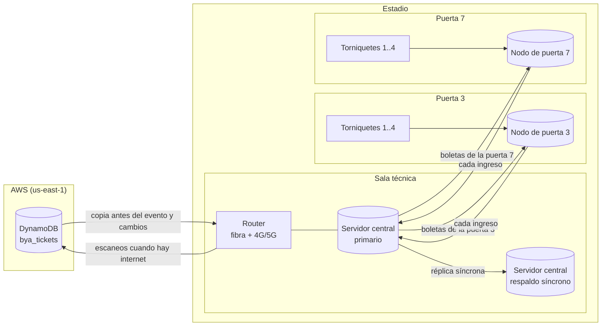

# Ingreso al estadio sin internet

**Autor:** David · **Fecha:** 2026-10-30 · **Rúbrica:** Ingreso al estadio sin internet (2 puntos)
**Insumos:** `jacobo/modelo_datos.md` §3.5 (`bya_tickets`), `jacobo/arquitectura.md` §7. Referencias `[R-xx]` en `jacobo/referencias.md`; `[D-xx]` en `david/concurrencia.md` §9 y al final de este documento.

> **Idea central:** cada boleta tiene **una sola puerta dueña**, y cada puerta tiene **un solo nodo** que decide con una escritura atómica. Dos puertas no pueden aceptar la misma boleta porque solo una tiene autoridad sobre ella, y dentro de la puerta el nodo serializa los escaneos. No hace falta internet ni conexión entre puertas para que esto se cumpla.

---

## 1. Resumen

| Pregunta | Respuesta |
|---|---|
| ¿Qué pasa si se cae internet? | Nada visible. El ingreso funciona con datos locales; internet solo sirve para sincronizar |
| ¿Qué pasa si una puerta queda aislada de la red del estadio? | Sigue operando sola, porque ya tiene todo lo que necesita para sus boletas |
| ¿Cómo se evita el doble ingreso entre dos puertas? | Asignación fija boleta → puerta. La otra puerta rechaza con "ingrese por la puerta X" |
| ¿Y dentro de la misma puerta, con dos torniquetes? | Un solo nodo por puerta marca la boleta con `UPDATE … WHERE st='VALID'`, que es atómico [D-05] |
| ¿Cuándo llega el registro a DynamoDB? | Apenas hay internet, con la transacción condicional de Jacobo; es idempotente y detecta duplicados [R-04] |

## 2. Supuestos

| ID | Supuesto | Por qué |
|---|---|---|
| E-01 | Cada localidad tiene **una puerta asignada**, impresa en la boleta ("Puerta 3") | Práctica habitual en estadios; es lo que hace posible la regla de autoridad |
| E-02 | Estadio de 45.000 personas con **12 puertas**, **4 torniquetes** por puerta | Para dimensionar el equipo; Juan Pablo puede ajustar las cantidades |
| E-03 | El ingreso dura 90 minutos: 45.000 / 5.400 s ≈ **8,3 escaneos/s** de promedio y **≈ 25/s** en el pico (×3, supuesto de Jacobo para AP-10) | Por puerta son ≈ 2/s en el pico: carga trivial para un nodo |
| E-04 | La red del estadio (cableado, energía) existe y la opera el estadio; BoletaYa instala sus equipos sobre ella | Fuera del alcance del curso |

## 3. Componentes



| Componente | Qué hace | Qué datos tiene |
|---|---|---|
| **Nodo de puerta** (uno por puerta) | **Única autoridad** sobre las boletas de su puerta. Valida el QR, marca la boleta usada y responde al torniquete | Las boletas de las localidades asignadas a su puerta y sus escaneos |
| **Servidor central** (primario + respaldo) | Descarga la copia del evento desde AWS y la reparte a los nodos. Recibe todos los ingresos, sube los escaneos a DynamoDB y muestra el tablero de aforo | Todas las boletas del evento y todos los escaneos |
| **Torniquete con lector QR** | Lee el QR, pregunta al nodo y abre o rechaza. No decide nada | Ninguno |
| **Router doble** | Salida a internet por fibra y por 4G/5G | — |

## 4. Antes del evento: la copia

1. **T − 24 h:** el servidor central descarga las boletas del evento con el patrón AP-18 de Jacobo: 8 consultas en paralelo a `gsi_evento_boleta`, ≈ 45.000 boletas ≈ 9 MB [R-07]. Recibe también la **clave HMAC** del QR (desde el gestor de secretos, nunca en la base) y la tabla **localidad → puerta** del catálogo.
2. El central reparte a cada nodo **solo las boletas de su puerta** (≈ 3.750 por puerta).
3. **Mientras haya internet**, el central recibe los **cambios** (boletas nuevas, anuladas por reembolso) y los reenvía al nodo dueño. Propuesta: Streams de `bya_tickets` → Lambda → una cola SQS por evento que el central consulta cada pocos segundos (los Streams retienen 24 h [R-11]). **Pendiente con Jacobo:** activar Streams en `bya_tickets`.

## 5. Durante el evento: un ingreso

En el nodo de la puerta, cada escaneo es **una sola sentencia**:

```sql
-- Nodo de la puerta 3. tid sale del QR después de verificar el HMAC.
UPDATE boletas
   SET st = 'USED', usado_en = now(), torniquete = $t
 WHERE tid = $tid
   AND st  = 'VALID'
   AND puerta = 3                -- solo boletas de esta puerta
RETURNING tid;
-- 1 fila  -> abrir torniquete
-- 0 filas -> rechazar: ya usada, anulada o de otra puerta (una lectura dice cuál, para el mensaje)
```

**Por qué dos torniquetes de la misma puerta no dejan entrar dos veces la misma boleta.** En PostgreSQL, si dos `UPDATE` llegan a la misma fila al mismo tiempo, el segundo **espera** a que el primero confirme y luego **vuelve a evaluar el `WHERE`** sobre la versión actualizada de la fila [D-05]. Como el primero ya dejó `st = 'USED'`, el segundo no encuentra la fila y devuelve 0 filas.

**Por qué dos puertas distintas no dejan entrar dos veces la misma boleta.** La boleta de la localidad Oriental solo existe con `st = 'VALID'` en el nodo de la puerta 3. Si alguien presenta una copia del QR en la puerta 7, el nodo 7 no tiene autoridad sobre ella y responde "ingrese por la puerta 3". No hace falta que las dos puertas se comuniquen.

Validaciones del QR (formato `v1.<tid>.<eid>.<hmac>` de Jacobo):

| Paso | Rechazo si… | Funciona sin red |
|---|---|---|
| 1. Firma HMAC | El QR fue alterado o inventado | Sí, el nodo tiene la clave |
| 2. Evento | `eid` no es el de hoy | Sí |
| 3. Puerta | La localidad de la boleta no es de esta puerta | Sí |
| 4. Estado | `UPDATE` devuelve 0 filas | Sí |

Luego el nodo envía el ingreso al servidor central. Si la red interna está caída, lo guarda en una cola local y lo envía cuando vuelva.

### Línea de tiempo: dos personas con la misma boleta (una es una captura de pantalla)

| t (s) | Puerta 3, torniquete 1 | Puerta 3, torniquete 2 | Puerta 7 | Boleta `TKT#01JC3B` en el nodo 3 |
|---|---|---|---|---|
| 0,000 | Escanea | Escanea | — | `VALID` |
| 0,002 | `UPDATE` toma la fila | `UPDATE` espera a que el primero termine [D-05] | — | `VALID` (bloqueada) |
| 0,004 | Confirma: 1 fila → **abre** | Vuelve a evaluar `st = 'VALID'`: falso → 0 filas | — | `USED` |
| 0,005 | — | **Rechaza**: "boleta ya usada a las 18:04:12 en el torniquete 1" | — | `USED` |
| 40,000 | — | — | Escanea la misma captura: localidad de la puerta 3 → **rechaza** "ingrese por la puerta 3" | `USED` |

## 6. Fallas y qué pasa en cada una

| Falla | Efecto en el ingreso | Por qué se mantiene la regla |
|---|---|---|
| **Sin internet** | Ninguno | Todo lo necesario está en el estadio. Los escaneos esperan en el central para subir |
| **Puerta aislada de la red interna** | Ninguno en esa puerta | El nodo es la autoridad de sus boletas; no necesita a nadie. Sus ingresos esperan en una cola local |
| **Cae el servidor central primario** | Ninguno en las puertas | El respaldo tiene todo, porque la réplica es síncrona: un `COMMIT` responde solo cuando el cambio está en el disco de ambos [D-06]. Los nodos se reconectan al respaldo |
| **Cae el respaldo del central** | Con réplica síncrona, el primario dejaría de confirmar | Al detectar la caída, se pasa la réplica a asíncrona y se genera una alerta. La autoridad de los ingresos está en los nodos, no en el central, así que el ingreso no se detiene |
| **Cae un nodo de puerta** | Esa puerta se detiene | Los torniquetes se pasan al servidor central, que toma la autoridad de esa puerta **solo cuando el operador confirma que el nodo está apagado** (se desconecta de la energía). Hasta ese momento hay dos posibles dueños y no se puede arriesgar. Si el nodo estaba aislado antes de caer, puede tener ingresos que no alcanzó a enviar: antes de que el central tome la puerta se recuperan desde su SSD. Hay un nodo de repuesto por cada 4 puertas |
| **Se va la luz en una puerta** | Esa puerta se detiene | UPS por puerta con autonomía para el ingreso |

**Por qué el cambio de nodo lo confirma una persona.** Un sistema no puede distinguir entre un nodo apagado y un nodo vivo pero desconectado. Si el central tomara la autoridad solo porque dejó de oír al nodo, y el nodo siguiera vivo atendiendo su puerta, habría dos dueños de las mismas boletas: es exactamente el doble ingreso que queremos evitar. Apagar el nodo antes de tomar su lugar garantiza que solo haya un dueño. Es un procedimiento manual de minutos, en una falla poco probable, que no arriesga la regla.

### 6.1 RPO y RTO del ingreso

El enunciado fija RPO 0 y RTO 15 minutos para la plataforma. Para el ingreso propongo estos valores, que Miguel pidió declarar:

| Falla | RPO de los ingresos | RTO de la puerta | Por qué |
|---|---|---|---|
| Sin internet | 0 | 0 | Los escaneos se guardan en el central y suben al volver (§7) |
| Puerta aislada de la red interna | 0 | 0 | El nodo confirma el `UPDATE` en su disco **antes** de abrir el torniquete |
| Cae el central primario | 0 | 0 en las puertas | Réplica síncrona: el respaldo tiene cada cambio confirmado [D-06] |
| Cae un nodo de puerta, con su disco sano | 0 | **Minutos** (supuesto: 5 a 10): apagar el nodo, recuperar su cola desde el SSD, el central toma la puerta | Paso manual a propósito (§6) |
| Cae un nodo **y se daña su disco** mientras estaba aislado | Los ingresos no enviados de ese aislamiento | Igual al anterior | Es el único caso con pérdida |
| Se va la luz en una puerta | 0 | 0 mientras dure la UPS | UPS por puerta |

**El único RPO distinto de 0** requiere dos fallas a la vez en la misma puerta: aislamiento de la red y daño del disco. Lo que se pierde no es dinero ni una venta, sino la marca de "usada" de esas boletas. Su efecto es que esas boletas podrían volver a entrar por **la misma** puerta. Para que esa ventana sea de segundos, el nodo envía cada ingreso al central apenas lo confirma, y la cola local solo crece mientras la puerta está aislada.

Los RTO son supuestos míos y se miden en el ensayo previo al evento (Miguel). No hay cifra publicada que citar: dependen del procedimiento.

## 7. Sincronización con DynamoDB

Cuando hay internet, el servidor central sube cada ingreso con la transacción de 2 ítems de Jacobo (`modelo_datos.md` §3.5), marcada como fuera de línea:

```text
TransactWriteItems   ClientRequestToken = H(tid, "SCAN")
  Update bya_tickets TKT#<tid> / T
         IF  st = 'VALID' AND eid = :eid
         SET st = 'USED', usa = :usado_en, pta = :puerta   ADD ver :uno
  Put    bya_tickets TKT#<tid> / SCAN#<usado_en>#<puerta>
         (res='OK', dis=:torniquete, off=true)
         IF attribute_not_exists(pk)
```

| Resultado | Significado | Acción |
|---|---|---|
| Éxito | Primera vez que se sube | Marcar sincronizado en el central |
| `ConditionalCheckFailed` y en la nube `usa` y `pta` son los mismos | Ya se había subido (reintento) | Marcar sincronizado |
| `ConditionalCheckFailed` y en la nube la boleta fue anulada (`VOID`) | Se reembolsó después de la última copia y alguien entró igual | Registrar `SCAN` con `res='DUPLICADA'` y reportarlo al organizador |
| `TransactionConflict` o *throttling* | Temporal | Reintento con *backoff* (mismas reglas de `concurrencia.md` §7) |

El orden de llegada no importa: cada boleta tiene un solo nodo que la marca, así que no hay dos versiones del ingreso que reconciliar.

**Volumen:** ≈ 45.000 transacciones por evento. A 25/s de pico son 100 WRU/s (2 ítems × 2 por transacción [R-02]), muy por debajo de lo que Jacobo dimensionó.

## 8. Riesgos y decisiones para el grupo

| # | Riesgo o decisión | Propuesta |
|---|---|---|
| E-R1 | **Boleta anulada (reembolso) sin internet:** el nodo no se entera y la deja entrar | Riesgo aceptado: se detecta en la sincronización (§7). Para reducirlo, cerrar reembolsos 2 h antes de abrir puertas |
| E-R2 | **Boleta vendida después de la última copia, sin internet:** el nodo no la conoce | Si el HMAC es válido, el evento coincide y la localidad es de esa puerta, **aceptar** y marcarla "fuera de copia". La firma garantiza que la emitió BoletaYa. Decisión del grupo |
| E-R3 | Asignación fija de puerta: si una puerta se llena, no se puede desviar gente a otra | El organizador puede reasignar una localidad a otra puerta **antes** del evento. Durante el evento, solo con el procedimiento manual de §6 |
| E-R4 | Clave HMAC robada de un nodo | Clave por evento, rotada después de cada uno; los nodos sin disco extraíble. Coordinar con Samuel |

## 9. Equipo para costear (para Juan Pablo)

Cantidades con los supuestos E-02 y E-03. **Los precios los pone Juan Pablo.**

| Equipo | Cantidad | Especificación mínima | Para qué |
|---|---|---|---|
| Servidor central | 2 | 1U, 8 núcleos, 32 GB RAM, 2 SSD en RAID 1, 2 fuentes | Primario y respaldo síncrono |
| Nodo de puerta | 12 + 3 de repuesto | Mini PC industrial sin ventilador, 8 GB RAM, SSD 128 GB, Ethernet | Una autoridad por puerta |
| Torniquete con lector QR fijo, Ethernet PoE | 48 | Lector 2D que lea pantallas de celular | 4 por puerta |
| Lector QR portátil | 24 | Android con lector 2D, Ethernet por base o Wi-Fi | 2 por puerta para filas de apoyo y accesibilidad |
| Switch PoE de puerta | 12 | 8 puertos PoE, 2 enlaces de subida | Conecta torniquetes y nodo |
| Switch de núcleo | 2 | 24 puertos, enlaces de fibra | Anillo redundante hacia las puertas |
| UPS de puerta | 12 | ≥ 2 h para nodo + switch + torniquetes | Corte de energía en una puerta |
| UPS de sala técnica | 2 | ≥ 2 h para servidores, núcleo y router | Corte en la sala técnica |
| Router con doble salida | 1 | Fibra + módem 4G/5G | Sincronización con AWS |
| Plan de datos 4G/5G | 1 | Bajo volumen (≈ 45.000 escaneos × ≈ 1 KB por evento) | Respaldo de internet |
| Rack, cableado, instalación | 1 lote | — | — |

### 9.2 Los torniquetes rompen el presupuesto del Escenario B (actualización del 2026-11-04)

Con los precios de Juan Pablo (`juanpablo/costos_boletaya.xlsx`), el Escenario B suma **COP 336,6 M en el año 1** frente a un tope de 280 M, aunque todavía faltan cotizaciones. Los 48 torniquetes son **COP 216,1 M** (48 × 3.784.000 + IVA, referencia AXCSS AX-KATRAX) y **solo cubren el cuerpo del torniquete**: el lector QR y el controlador van aparte. Son casi dos tercios del total.

**¿Sobran torniquetes? No.** La entrada necesita unas 500 personas por minuto de promedio (45.000 en 90 minutos) y unas 1.500 en el pico (E-03). Un torniquete de trípode pasa 25 personas por minuto según la ficha del ZKTeco T2000 [D-19]; el Hikvision DS-K3G530X declara entre 30 y 60, "según la forma de paso" [D-20].

| Torniquetes | Capacidad a 25 por minuto | ¿Alcanza para el promedio (500/min)? | ¿Y para el pico (1.500/min)? |
|---|---|---|---|
| 20 | 500/min | Justo | No: se forma cola |
| 24 | 600/min | Sí | No: se forma cola |
| 48 (diseño actual) | 1.200/min | Sí | Casi: cola corta |
| 60 | 1.500/min | Sí | Sí |

Reducir el número ahorra poco sin empeorar el ingreso. **El ahorro grande está en no comprarlos.** Mi diseño no depende del torniquete: la autoridad es el nodo de la puerta, y cualquier lector que le envíe el `tid` funciona con el mismo `UPDATE` de §5. Por eso cambiar el tipo de equipo de la puerta **no toca** la regla contra el doble ingreso.

| Opción | Qué compra BoletaYa | Torniquetes en el año 1 | Total B año 1 (aprox.) | Ventajas | Riesgos |
|---|---|---|---|---|---|
| **1. Actual** | 48 torniquetes + lectores | COP 216,1 M + lectores | 336,6 M + lectores | Control físico total | **Supera el tope** |
| **2. Usar los torniquetes del estadio** | 48 lectores QR con salida Wiegand o relé que abren el torniquete existente | 0 | ≈ 120,5 M + lectores + integración | El mayor ahorro; los estadios grandes suelen tener control de acceso (por confirmar) | Integrar con equipos ajenos; depende de cada estadio |
| **3. Alquilar torniquetes por evento** | Lectores; torniquetes en arriendo | Costo por evento (OPEX) | Sin cifra | Sin inversión inicial | Sin cotización; montaje en cada evento |
| **4. Carriles con lector portátil** | 48 terminales Android con lector 2D, vallas y personal | 0 | ≈ 120,5 M + terminales + personal | Barato y flexible | Sin barrera física; más personal. El paso por persona no lo pude verificar |
| **5. Comprar 24 torniquetes** | 24 torniquetes + lectores | ≈ COP 108,1 M | ≈ 228,6 M + lectores | Cabe en el tope con lo que hay hoy | Cola en el pico; los pendientes pueden volver a romper el tope |

Notas de precio:
* La referencia de terminal portátil es el Zebra TC22 a 940,95 EUR en una tienda de España [D-21]. **No es precio de Colombia ni cotización**; sirve solo para el orden de magnitud. El Excel ya tiene 24 lectores portátiles sin precio.
* No encontré un precio en Colombia de un lector QR fijo con salida Wiegand. Sirven las fichas de los torniquetes de [D-19] y [D-20], que tienen entradas Wiegand para lectores externos.

**Propuesta:** opción 2 como base, con la 4 como respaldo en estadios sin torniquetes compatibles, y la 1 solo si el cliente exige equipo propio. Depende de la pregunta 45 que ya se le envió al profesor ("¿Tienen ya equipos en los estadios o debemos comprar todo?"). Mientras no responda, Juan Pablo puede mostrar el Escenario B con la opción 1 y con la 2, para que se vea que la diferencia es el equipo de puerta y no la arquitectura.

### 9.1 Sistema operativo y fin de soporte (regla de Miguel: al menos 5 años desde la compra)

Miguel dejó el sistema operativo de los servidores y del nodo de puerta sin definir y puso la regla de elegir uno con soporte de al menos 5 años desde la compra, o costear su actualización. Propuesta, con fechas consultadas el 2026-11-03 [D-15, D-16]. Supuesto mío: compra a inicios de 2027, por lo que 5 años llegan a inicios de 2032.

| Componente | Propuesta | Fin del soporte estándar | ¿Cubre 5 años desde 2027? | Qué hacer |
|---|---|---|---|---|
| Sistema operativo del servidor central y de los nodos de puerta | Ubuntu 26.04 LTS (lanzada en abril de 2026) | Mayo de 2031 | **No del todo** (≈ 4,4 años) | Contratar Ubuntu Pro (mantenimiento de seguridad ampliado hasta mayo de 2036) o planear el cambio de versión en 2031 |
| Alternativa | Ubuntu 24.04 LTS | Mayo de 2029 (ampliado hasta mayo de 2034) | No (≈ 2,4 años estándar) | Solo con Ubuntu Pro; no la recomiendo para equipo nuevo |
| Base local | PostgreSQL 18 | 14 de noviembre de 2030 | **No** (≈ 3,9 años) | Una migración a una versión mayor nueva en 2030; Miguel ya costea "migraciones de runtime", falta sumar esta |

Conclusiones:
1. **Ninguna combinación llega a 5 años sin acción extra.** Con la regla de Miguel, hay que costear (a) Ubuntu Pro por equipo o una actualización de sistema operativo hacia 2031, y (b) una actualización mayor de PostgreSQL hacia 2030.
2. **Para Juan Pablo:** sumar al costo a 5 años una migración de PostgreSQL (horas de DBA, ensayo previo en un evento sin público) y una de estas dos opciones para el sistema operativo:

   | Opción | Cuándo se paga | Costo | Fuente |
   |---|---|---|---|
   | Ubuntu Pro solo el último año (de mayo de 2031 a inicios de 2032) | Un año | Servidor: USD 500 por máquina al año. Escritorio: USD 25 por máquina al año. El soporte 24/7 es aparte (USD 1.775 a 3.400 por servidor al año) | [D-17] |
   | Cambiar a la siguiente LTS antes de mayo de 2031 | Una vez | Horas de técnico por equipo, sin licencia | Supuesto mío |

   Con 14 equipos instalados como servidor, la primera opción cuesta 14 × 500 = **USD 7.000 por un año**. Si los 12 nodos de puerta usan la edición de escritorio, baja a 2 × 500 + 12 × 25 = **USD 1.300**. No pude confirmar en la página qué tarifa aplica a un nodo de puerta. Recomiendo la segunda opción si el cambio se puede hacer en temporada sin eventos.
3. **Lectores y torniquetes:** su firmware y soporte dependen del fabricante, que aún no está elegido. No lo verifiqué; queda como requisito de compra: soporte y repuestos del fabricante por 5 años como mínimo, por escrito.
4. **Mientras no se defina**, el supuesto de 12 puertas (12 nodos más 2 servidores) fija la cantidad de licencias de Ubuntu Pro a costear: 14 equipos.

Costos recurrentes a considerar: garantía y soporte de los equipos, reposición de lectores, el plan de datos, el personal técnico el día del evento y el transporte si los equipos se mueven entre estadios.

## 10. Referencias propias

| ID | Fuente | Qué respalda |
|---|---|---|
| D-05 | [PostgreSQL: Transaction Isolation (Read Committed)](https://www.postgresql.org/docs/current/transaction-iso.html) | Un `UPDATE` sobre una fila que otra transacción está actualizando **espera**; si la primera confirma, el `WHERE` **se vuelve a evaluar** sobre la versión nueva |
| D-06 | [PostgreSQL: Log-Shipping Standby Servers, §26.2.8 Synchronous Replication](https://www.postgresql.org/docs/current/warm-standby.html) | Cada confirmación espera a que el cambio esté escrito en el disco del primario y del respaldo; solo hay pérdida si ambos fallan a la vez |
| D-15 | [Ubuntu release cycle](https://ubuntu.com/about/release-cycle) | Ubuntu 26.04 LTS: mantenimiento estándar hasta mayo de 2031 y ampliado hasta mayo de 2036; 24.04 LTS: mayo de 2029 y mayo de 2034; las LTS reciben 5 años de mantenimiento estándar |
| D-16 | [PostgreSQL versioning policy](https://www.postgresql.org/support/versioning/) | Cada versión mayor recibe 5 años de soporte; PostgreSQL 18 llega a fin de vida el 14 de noviembre de 2030 |
| D-17 | [Ubuntu Pro pricing](https://ubuntu.com/pricing/pro) | Ubuntu Pro: USD 500 por servidor al año (máquinas virtuales ilimitadas) y USD 25 por escritorio al año; soporte 24/7 aparte |
| D-19 | [ZKTeco T2000, ficha técnica (TVC)](https://cdn.tvc.mx/media/1825683/Torniquete-T2000-ZKTECO-TVC-Ficha-Tecnica-Español.pdf) | Torniquete de trípode: 25 personas por minuto |
| D-20 | [Hikvision DS-K3G530X, ficha técnica](https://assets.hikvision.com/prd/normal/all/doc/m000125280/es-la/DS-K3G530X_Datasheet_20251027.pdf) | 30 a 60 personas por minuto según la forma de paso; 2 entradas Wiegand para lectores externos |
| D-21 | [Zebra TC22 en LDLC (España)](https://www.ldlc.com/es-es/ficha/PB00746032.html) | 940,95 EUR; Android 13, lector 2D SE4710, Wi-Fi 6 (referencia de orden de magnitud, no de Colombia) |

Consultadas el 2026-10-30 (D-05, D-06) y el 2026-11-03 (D-15 a D-17) y el 2026-11-04 (D-19 a D-21).
