# 0. Resumen ejecutivo

**Asignación:** Amazon DynamoDB en AWS. **Recomendación: Escenario A (todo en AWS, con el ingreso del estadio local).**

| | Escenario A — nube | Escenario B — híbrido |
|---|---|---|
| Qué es | Aplicación y base en AWS (us-east-1, alterna us-east-2); estadio local | Aplicación y caché en el data center de Bogotá; base en AWS; estadio local |
| Costo año 1 (caja) | **COP 194,0 M** de 280 M (sobran 86,0 M) | **COP 291,1 M**: se pasa 11,1 M y **usa la reserva del 10 %** (queda margen de 16,9 M) |
| Peor año 2–5 | COP 86,1 M de 130 M (año 5) | COP 122,0 M de 130 M (año 5) |
| Caja 5 años / TCO con horas | COP 473,7 M / 619,9 M | COP 699,8 M / 874,8 M |
| Latencia de base por compra | ≈ 22 ms (aplicación junto a la base) | ≈ 353 ms (≈ 4,3 viajes × 77 ms al cruzar el enlace) |
| RPO / RTO de la venta ante pérdida del sitio | Pagos 0; 4 a 11 min (región) | Igual, más 3 a 11 min si cae el data center |
| Doble preventa + doble cola, año 5 | Sigue cabiendo (sobran 24,6 M) | **No cabe** (faltan 11,3 M) |

Los costos salen de `costos_boletaya_final.xlsx` (anexo H): todas las líneas tienen precio con fuente y fecha, y las de hardware y las principales de AWS tienen captura en `entrega/evidencias/`. B solo cabe en el año 1 usando la reserva del 10 % y quitando la caché en espera de us-east-2 (F-25).

**Cinco ideas sostienen el diseño:**

1. **El pico manda.** 60.000 boletas en 20 minutos son 24.000 órdenes, unas 20 por segundo; con conflictos y ráfaga ×5 son ≈ 10.546 WRU/s con margen. DynamoDB on-demand con pre-calentamiento lo absorbe por **USD 83 de throughput al año** (año 1); tener esa capacidad fija todo el año costaría USD 63.176.
2. **El mapa no toca la base.** 250.000 personas consultando cada 10 s serían 17,2 veces la cuota de una tabla. Se sirven instantáneas desde CloudFront y la base ve ≈ 450 RRU/s.
3. **Cero doble venta** con escritura condicional sobre cada silla dentro de una transacción todo o nada. Los 4 escenarios del anexo B pasan en un simulador: **50 de 50 casos**.
4. **Pérdida de región:** una sola región escribe; se congelan solo las sillas con pagos en duda (lista en `bya_ledger`, MRSC, RPO 0) y se reabre en **4 a 11 minutos** estimados. El RPO 0 de los pagos lo da la conciliación con Mercado Pago, no la réplica.
5. **Estadio sin internet 4 horas:** cada boleta tiene una puerta dueña y cada puerta un nodo que decide con una escritura atómica.

**Lo que no está medido** (se dice en cada sección): ningún tiempo de recuperación, la latencia contra AWS (es un ping de terceros) y la frecuencia de conflictos de transacción. El proyecto es de diseño: no se creó infraestructura.

# 1. Contexto, alcance y supuestos

El grupo interpretó el enunciado con las 7 respuestas del profesor del 4 de noviembre (anexo G): A es todo en AWS; B es híbrido; el "sitio" es la región (nube) o el data center (Bogotá); el RTO se mide desde la declaración hasta que se aceptan compras sin poder vender una silla en duda; el estadio opera aislado 4 horas.

**Contradicciones del enunciado y cómo se resolvieron** (detalle en `jacobo/README.md` §5):

| # | Contradicción | Resolución |
|---|---|---|
| C-1 | 60.000 boletas por preventa > 45.000 sillas de un estadio | Varias fechas o festival; se dimensiona el peor caso |
| C-2 | 8.000/día × 365 + 25 × 60.000 = 4,42 M ≠ 4,0 M boletas | Almacenamiento con 4,0 M; carga con 8.000 y 60.000 |
| C-3 | "100 ventas por minuto" frente a 8,3 boletas/min | Se usa la §3; sensibilidad incluida |
| C-4 | Pide CPU, IOPS, compresión y espacio libre | DynamoDB no los expone: se traduce a RCU/WCU |

Supuestos numerados A-01 a A-12 en `jacobo/README.md` §4 (eventos +30 %/año, máximo 10 sillas por orden, pico instantáneo ×5, retención en línea de 2 años, etc.).

# 2. Los dos escenarios y por qué DynamoDB no va *on premise*

## 2.1 Por qué DynamoDB no puede instalarse en el data center

* **DynamoDB es un servicio administrado** que solo existe dentro de una región de AWS. No hay binario, edición ni licencia que instalar.
* **DynamoDB Local** existe, pero AWS lo describe como una versión descargable "para desarrollar y probar" [R-33]; no tiene replicación, alta disponibilidad, PITR ni soporte de producción.
* **AWS Outposts y Local Zones no lo ejecutan.** DynamoDB no aparece en las listas de servicios locales de Outposts [R-34]. La página de Local Zones lista EC2, EBS, VPC, ECS, EKS, ElastiCache y RDS en algunas zonas, y dice que desde ellas se llega "a toda la gama de servicios, como Amazon DynamoDB", **en la región** [S-08].
* **AWS en Colombia hoy:** un punto de presencia de CloudFront en Bogotá [R-26], Direct Connect en Equinix BG1 (1, 10 y 100 Gbps) [R-27] y una Local Zone de Bogotá (`us-east-1-bog-1a`) que figura como **anunciada**, no disponible, y cuya región madre es us-east-1 [S-07]. No hay región de AWS en Colombia, y aunque la Local Zone abriera, DynamoDB seguiría corriendo en us-east-1.

## 2.2 ¿Existe una alternativa *on premise* compatible con la API de DynamoDB?

Sí: **ScyllaDB Alternator**, "un proyecto de código abierto para una API compatible con Amazon DynamoDB", que corre en servidores propios o en otras nubes y permite conservar el código cliente [S-09]; GE Healthcare lo usó para llevar DynamoDB *on premise* [S-10].

**Por qué no lo usamos:**

1. **No es el motor asignado.** El enunciado exige que el motor asignado guarde la verdad transaccional; Alternator es otro motor con la API de DynamoDB.
2. **Compatibilidad no verificada en lo que más importa.** El diseño depende de `TransactWriteItems`, escrituras condicionales, Streams y TTL. La documentación consultada de Alternator no confirma esas funciones [S-09], y la regla "función usada que no existe en la edición elegida" (−0,5) aplicaría.
3. **Costo y riesgo de operarlo.** Un clúster distribuido necesita al menos 3 nodos dimensionados para el pico (≈ 10.500 escrituras/s) y un segundo sitio para cumplir RPO 0 ante la pérdida del data center, que no tiene planta eléctrica.

**Decisión (ficha F-01):** Escenario B híbrido, aceptado por el profesor: aplicación, caché y estadio en Bogotá; DynamoDB en AWS.

## 2.3 Arquitecturas

{width=82%}

{width=70%}

**Cambio respecto al borrador de arquitectura:** en B la conexión a AWS es **VPN sobre dos enlaces dedicados de proveedores distintos** (1 Gbps y 512 Mbps), con precio público de Colombia Compra Eficiente [S-11], en lugar de Direct Connect, cuyo puerto en Equinix, *cross-connect* y circuito no tienen precio publicado. Direct Connect queda como mejora si la latencia por VPN resultara inaceptable (ficha F-18).

# 3. Capacidad (5.1)

Fuente: `jacobo/capacidad_y_volumetria.md` y el script `jacobo/calculos/modelo_capacidad.py` (anexo E). Todas las cifras son reproducibles.

## 3.1 Volumen de datos

| Año | 1 | 2 | 3 | 4 | 5 |
|---|---|---|---|---|---|
| Tablas + GSI en línea (GiB) | 48,0 | 104,0 | 135,8 | 177,4 | 231,8 |
| Archivo en S3 acumulado (GiB) | 0 | 1,6 | 34,1 | 76,3 | 131,2 |

Usuarios +40 %, boletas +30 %, eventos +30 % (A-01), auditoría +30 % (A-02). Sobrecarga de 100 B por ítem (A-03). Los "niveles de almacenamiento" son: tablas Standard en línea (2 años), S3 para el histórico consultable con Athena, y S3 con Object Lock para la retención legal (§8.4).

## 3.2 Carga

| | Operación normal | Preventa (minuto pico) |
|---|---|---|
| Órdenes | 3.200/día ≈ 0,056/s | 24.000 en 20 min ≈ **20/s** |
| Escritura por orden | — | 55,3 WRU mínimo · 84,4 planificación · 182,9 estrés |
| Escritura total | ≈ 3,5 WRU/s | ≈ 1.690 WRU/s promedio · ≈ 8.440 en ráfaga ×5 · **10.546 con margen 25 %** |
| Lectura | baja | ≈ 2.200 RRU/s (planificación ×5) |

**Por qué 84,4 WRU por orden:** cada compra bloquea sillas (transacción ×2), escribe orden, intentos de pago (1,3 por orden), factura, contadores, boletas e historial, y por cada bloqueo exitoso se suponen 2 fallidos (A-10), que también cobran. La traducción a CPU, memoria e IOPS no aplica: DynamoDB factura y limita por unidades de lectura y escritura.

## 3.3 Cómo se atiende el pico

| Opción | Throughput año 1 (USD) | Veredicto |
|---|---|---|
| **On-demand + pre-calentamiento** | **83** (us-east-1) | **Elegida** |
| Provisionado con escalado programado | 880 | Plan B |
| Provisionado fijo al pico | 63.176 | Descartada: el uso medio sería 0,037 % |
| Auto scaling reactivo | — | Descartado: dispara tras 2 min y tarda varios [R-20] |

El pre-calentamiento (*warm throughput*) se pide 24 h antes de cada preventa: ≈ 6.000 WRU/s para sillas y órdenes, 3.000 para contadores y 1.500 para boletas. Es un cargo único (≈ USD 13 en la hoja).

## 3.4 Qué va a la base y qué no

| A la base (verdad) | Fuera de la base |
|---|---|
| Bloquear, pagar, confirmar, emitir boleta, escaneo válido, contador exacto | Mapa de sillas (instantáneas en CloudFront, TTL 2 s): 25.000 req/s → ≈ 450 RRU/s en la base |
| | Posición en la cola (objeto cacheable), catálogo (caché), histórico (S3 + Athena) |

Ninguna venta depende solo de la caché o de la cola: si la caché dice "libre", la transacción decide igual.

# 4. Concurrencia y consistencia (5.2)

Fuente: `david/concurrencia.md`, anexo B (`david/anexo_concurrencia.md`) y `david/estadio.md`.

**Qué es doble venta** (respuesta 5 del profesor): dos boletas válidas o dos órdenes pagadas para una silla, o dos bloqueos activos sobre la misma silla.

## 4.1 Modelo de datos (resumen)

Ocho tablas (F-03): `bya_seats` (PK `E<evento>#S<localidad>#R<fila>`, SK `S<número>`, **sin GSI**), `bya_orders` (orden + intentos de pago + factura), `bya_counters` (contador fragmentado y límite por usuario), `bya_tickets` (boleta y escaneos), `bya_catalog`, `bya_users`, `bya_seat_history`, `bya_audit`; más `bya_ledger` (MRSC) para la recuperación. La clave por fila da ≈ 900 particiones por estadio y ≈ 2,5 WRU/s por clave en el pico, lejos del límite de 1.000 escrituras/s por partición (F-04).

## 4.2 Cómo se garantiza que una silla no se venda dos veces

* **Control optimista con condición, no bloqueos que esperan.** El bloqueo de las sillas es un `TransactWriteItems` todo o nada: por cada silla, `st = 'A' OR (st = 'L' AND lx < :vencido_antes_de)`; además crea la orden y descuenta el límite antibot. Las transacciones son serializables entre sí [R-04]; si dos clientes piden la misma silla, una transacción gana y la otra se cancela completa (`TransactionCanceledException` con el motivo por ítem).
* **Bloqueo de 8 minutos en la propia silla** (`lx`, `lo`). Una silla vencida se trata como disponible **dentro de la condición**; el TTL de DynamoDB solo limpia (borra "típicamente en pocos días" [R-08]). `:vencido_antes_de = ahora − 2 s` lo calcula la aplicación, porque una `ConditionExpression` no admite aritmética.
* **Confirmación:** `st = 'L' AND lo = :orden` (si el bloqueo venció pero nadie tomó la silla, sigue siendo de la orden). En la misma transacción: silla vendida, orden pagada, boletas, factura pendiente y fragmento del contador (`hash(orden) mod 8`). El **contador es exacto** porque se vende y se cuenta a la vez (F-05).
* **Contención y bloqueos mutuos:** no hay *deadlocks* clásicos; un choque cancela la transacción. Reintentos con *backoff* y *jitter*, máximo 3, y la cola virtual limita cuántos compradores entran a la vez.

## 4.3 Pagos a medias

| Caso | Qué pasa |
|---|---|
| Pasarela aprueba y la base falla antes de registrar | El intento se escribe antes de cobrar (`PAY#nn = INITIATED`) y en `bya_ledger`. El reconciliador revisa cada minuto los pagos con más de 5 minutos y confirma de forma idempotente; si la silla ya no es de la orden, `FULFILL_FAIL` y reembolso |
| Base registra y la pasarela no confirma | El pago queda `UNKNOWN`; se consulta a Mercado Pago por el `id`; si fue rechazado, la silla se libera al vencer el bloqueo |
| Reintento del cliente o webhook duplicado | `X-Idempotency-Key = <orden>#<nn>` devuelve el mismo pago (confirmado en el sandbox: HTTP 201 y luego 200 con el mismo id) y `ClientRequestToken` protege la transacción 10 minutos; después protege la condición |

## 4.4 Ingreso al estadio sin internet

Cada localidad tiene una puerta asignada; cada puerta, un nodo que marca `VALID → USED` con un `UPDATE` atómico antes de abrir. Otra puerta rechaza con "ingrese por la puerta X". Sin internet (hasta 4 horas) el ingreso no cambia; los escaneos suben después con una transacción idempotente. Si cae un nodo, el central toma su puerta **solo después de que una persona confirma que el nodo está apagado** (5 a 10 min, supuesto), para que nunca haya dos autoridades (F-13).

## 4.5 Evidencia

Las transacciones de los cuatro escenarios del anexo B (misma silla, bloqueo que vence mientras paga, falla a mitad de compra, conmutación) se ejecutaron en un **simulador local de DynamoDB (moto)**, no en AWS: **50 de 50 casos pasan** (`david/pruebas/resultado.txt`). El simulador no reproduce la latencia ni la concurrencia real; la garantía viene de la semántica documentada de las transacciones [R-04].

# 5. Versiones y licenciamiento (5.3)

Fuente: `miguel/recuperacion_licenciamiento_carta.md` §5.3 y `david/estadio.md` §9.1.

* **DynamoDB no tiene versión del motor, edición ni licencia por núcleo:** se paga por unidades y GB. Escalar en preventa o tener réplicas no agrega licencias; el costo está en las escrituras replicadas, ya incluidas en la hoja.
* **Lo que sí tiene fin de soporte, y su plan:**

| Componente | Fin de soporte | Plan |
|---|---|---|
| SDK de AWS | Versión mayor: ≥ 24 meses completo + 12 de mantenimiento, aviso ≥ 6 meses | Revisión semestral; 1 migración mayor (24 h) |
| Runtime Lambda: Node.js 24 | 30-abr-2028 | 2 migraciones en 5 años (40 h c/u) |
| ElastiCache Valkey 9.1 | Sin fecha publicada | Revisión semestral; soporte extendido como riesgo |
| Ubuntu 26.04 LTS (estadio y B) | Mayo de 2031 | Ubuntu Pro solo el último año (USD 500 servidor, USD 25 nodo) |
| PostgreSQL 18 (estadio) | 14-nov-2030 | 1 migración mayor en 2030 (24 h) |

Plan de actualización: COP 15.360.000 en 5 años en horas (TCO) más Ubuntu Pro en el año 5. **Compatibilidad:** DynamoDB, Lambda y ElastiCache son servicios de la misma región; el SDK de AWS soporta todas las operaciones usadas (`TransactWriteItems`, condiciones, Streams).

# 6. Arquitectura y alta disponibilidad (5.4)

* **Región us-east-1, alterna us-east-2** (F-02). Desde Bogotá: ≈ 77 ms a Washington frente a ≈ 112 ms a São Paulo (ping de terceros [R-25], no contra AWS); DynamoDB cuesta 50 % más en São Paulo, que además no tiene MRSC.
* **Dentro de la región:** DynamoDB replica en 3 zonas y confirma la escritura tras replicar; falla de zona = RPO 0, sin conmutación, SLA 99,99 % [R-01, R-22].
* **Entre regiones:** tabla global **MREC con una sola región que escribe** (F-09). MRSC daría RPO 0 pero "no soporta operaciones de transacción" ni TTL [R-17]; MREC es asíncrona (típicamente ≤ 1 s, sin SLA) y "la última escritura gana", por eso solo escribe us-east-1.
* **Efecto en el tiempo de respuesta:** la replicación entre zonas está incluida en la latencia normal de DynamoDB; MREC es asíncrona y no la aumenta. `bya_ledger` (MRSC) añade una escritura sincrónica entre regiones en el camino del pago, sin medir.
* **Conmutación de la venta:** por DNS (Route 53) o a mano; el *origin failover* de CloudFront no conmuta `POST` [R-40].
* **Recorrido de una compra:** cola → token → bloqueo (transacción) → `bya_ledger` + intento de pago → Mercado Pago → confirmación (transacción) → Streams actualiza mapa e historial → SQS emite la factura.

# 7. Recuperación (5.5)

Fuente: `miguel/recuperacion_licenciamiento_carta.md` y anexo C (`david/alta_disponibilidad.md`).

## 7.1 Respaldo

| Capa | Qué cubre | Configuración |
|---|---|---|
| Replicación en 3 zonas | Falla de zona | Automática |
| **PITR 35 días** en las 8 tablas, en us-east-1 y en us-east-2 (no se sincroniza solo) | Error humano, corrupción | Granularidad de 1 s; restaurable desde 5 min antes de ahora [R-42] |
| **AWS Backup** semanal (5) y mensual (13) de tablas críticas, en bóveda con **Vault Lock** y copia a **otra cuenta en us-east-2** | Cuenta comprometida, ransomware | Vault Lock probado antes en modo gobernanza (F-12) |
| Exportación incremental diaria a S3 con Object Lock | Histórico y retención legal | Consulta con Athena |
| Réplica MREC en us-east-2 | Pérdida de región | Ver §7.3 |

**Ajuste de costo (F-17):** Miguel proponía además copias diarias de AWS Backup con 35 días; como PITR ya da cualquier segundo de esos 35 días, la copia inmutable pasa a semanal y mensual. Una cuenta comprometida arriesga hasta 7 días en la copia inmutable (PITR sigue cubriendo lo demás mientras la cuenta no se pierda).

**Respaldar sin frenar la preventa:** según AWS, el respaldo bajo demanda es "sin impacto en el rendimiento y la disponibilidad", PITR "no afecta el rendimiento ni las latencias de la API" y la exportación no consume RCU. No hay ventana de respaldo ni respaldo desde réplica. Aun así: congelamiento de cambios desde 24 h antes hasta 3 h después de cada preventa, trabajos de respaldo de 1:00 a 5:00 a. m. y nunca un `Scan`.

## 7.2 RPO y RTO por componente

| Componente | Meta | Alcanzado (estimado, sin medir) |
|---|---|---|
| Venta, falla de zona | 0 / 15 min | 0 / sin conmutación |
| Venta, pérdida de región | 0 / 15 min | Pagos 0 con sillas en duda congeladas; **RTO 4 a 8 min** (4 a 11 en secuencia) desde la declaración; detección y declaración aparte: 2 a 5 min |
| Venta, pérdida del data center (solo B) | 0 / 15 min | 0 / 3 a 11 min (aplicación en espera en AWS) |
| Operación normal | 0 / 1 h | Igual que la preventa |
| Ingreso al evento | Nunca se detiene | RPO 0 y RTO 0 sin internet; 5 a 10 min si cae el nodo de una puerta |
| Usuarios, catálogo, analítica | 15 min / 4 h | Segundos (PITR) / minutos a horas |
| Histórico | 24 h / 48 h | ≤ 24 h / horas (S3 replicado con RTC) |

**Criterio de declaración:** alarma compuesta de CloudWatch (errores del sistema, `ReplicationLatency`, 5xx del API) **y** Route 53 en falla (3 revisiones de 30 s) **y** confirmación humana.

## 7.3 Pérdida de región: RPO 0 de pagos por conciliación

El profesor aceptó el RPO 0 de pagos por conciliación con tres condiciones, todas atendidas:
(a) **atraso de replicación con fuente:** típicamente ≤ 1 s [D-07], sin SLA [D-08]; Capital One midió ≈ 1 s y vio que crece bajo carga [D-14]; se diseña para 60 s con alarma;
(b) **ninguna silla en duda se vende hasta conciliarla:** las sillas de los pagos registrados en `bya_ledger` desde `T − W` (W = 8 min de bloqueo + 2 de margen + último atraso) se congelan antes de reabrir; la búsqueda por fechas de Mercado Pago no funcionó en el sandbox, por eso la lista sale del libro (F-10);
(c) **RTO ≤ 15 min:** peor caso estimado 11 min; si el simulacro midiera más, se automatiza el cambio de tráfico con Application Recovery Controller.

## 7.4 Runbooks y pruebas

Runbooks completos en el anexo F: **1** caída del servidor principal (aplicación, caché o *throttling*) en plena preventa; **2a** zona, **2b** región (declarar → cerrar admisión → tráfico a us-east-2 → congelar sillas en duda desde `bya_ledger` → reabrir → conciliar → liberar y reconstruir contadores), **2c** data center (solo B); **3** pago aprobado sin registro (reconciliador, confirmación idempotente o reembolso con llave `refund#<orden>`).

**Plan de pruebas:** simulacro de conmutación regional 30 días antes de la preventa más grande (criterio: RTO ≤ 15 min, 0 sillas con dos dueños, verificador de invariantes de David), restauración completa anual desde la bóveda, restauración PITR trimestral y prueba mensual del runbook 3. Toda restauración incluye la lista de ajustes que no se restauran (Streams, TTL, IAM, alarmas, PITR) [R-41].

# 8. Seguridad y cumplimiento (5.6)

## 8.1 Roles y mínimo privilegio (IAM)

| Rol | Puede | No puede |
|---|---|---|
| `app-compra` (Lambda / servidores B) | `TransactWriteItems`, `UpdateItem`, `GetItem`, `Query` en sillas, órdenes, contadores, boletas y `bya_ledger` | Borrar tablas, leer `bya_users` completo, cambiar precios |
| `reconciliador` | Leer `gsi_pendientes`, actualizar pagos y órdenes, encolar reembolsos | Tocar el catálogo |
| `estadio-sync` | `UpdateItem` condicional y `PutItem` de escaneos en `bya_tickets` | Cualquier otra tabla |
| Organizador (vía aplicación) | Ver contadores y ventas de **sus** eventos; pedir cambios de precio o cupo, que quedan auditados | Acceso directo a la base |
| Soporte al cliente (vía aplicación) | Ver órdenes con cédula y teléfono **enmascarados** (últimos 4 dígitos) | Ver tokens de pago (`gtk`, `gtx`): se niegan con control de acceso por atributo [R-01] |
| DBA | Rol de emergencia con MFA, sesión registrada en CloudTrail | Borrar tablas o respaldos: lo impiden la protección contra borrado y una política de la organización |
| Auditor | Solo lectura de `bya_audit`, CloudTrail y el bucket de auditoría | Escribir |

## 8.2 Cifrado y llaves

DynamoDB cifra todo en reposo por defecto; se usa **llave de KMS administrada por el cliente** para las tablas con datos personales y pagos, y otra en la cuenta de respaldo. En tránsito, TLS en todos los *endpoints* de AWS e IPsec en la VPN del Escenario B. La cédula y el teléfono se cifran además en la aplicación (campos `*_c`); el correo se indexa por su SHA-256. La llave HMAC que firma los QR vive en KMS, es **por evento** y se rota tras cada uno (riesgo E-R4). Costo: 3 llaves y 10 M solicitudes al año en la hoja.

## 8.3 PCI DSS: fuera del alcance

El número de tarjeta lo captura en el navegador el formulario seguro de **Mercado Pago** (su Checkout o la tokenización de su SDK), que devuelve un token: la tarjeta nunca pasa por los servidores ni por la base de BoletaYa. La base guarda solo el `id` del pago y el token (`gtk`, `gtx`). Para que ningún log o respaldo contenga una tarjeta: los registros de acceso del API no guardan cuerpos de solicitud, WAF redacta campos sensibles y la `metadata` enviada a Mercado Pago lleva solo identificadores (evento, usuario, sillas), sin nombres ni documentos. Como BoletaYa no almacena, procesa ni transmite el dato de tarjeta, el entorno de datos de tarjeta queda en la pasarela y la base de BoletaYa fuera del alcance de PCI DSS; AWS declara además que DynamoDB está en el alcance de su certificación PCI [R-01].

## 8.4 Auditoría antifraude y retención

* **Cambios de precio, cupo o silla hechos por personas:** la aplicación escribe en `bya_audit` **dentro de la misma transacción** que el cambio (actor, antes, después, solicitud): no se puede cambiar sin rastro. Los cambios automáticos de sillas quedan en `bya_seat_history` (por Streams). CloudTrail registra los cambios de control (tablas, roles); Streams no trae la identidad del actor, por eso la auditoría humana no depende de él. Alarma si hay cambios de precio o cupo durante una preventa.
* **Plazo de conservación:** el artículo 632 del Estatuto Tributario remite al artículo 46 de la Ley 962 de 2005, que iguala el plazo de conservación de las pruebas tributarias al **término de firmeza** de la declaración de renta [S-01]; la regla comercial (art. 28 de la Ley 962 de 2005, que modifica el art. 60 del Código de Comercio) obliga a conservar libros y papeles del comerciante **10 años** [S-02]. Como BoletaYa SAS es comerciante, se aplica el plazo mayor: **2 años en línea y luego S3 con Object Lock en modo cumplimiento hasta completar 10 años**, consultable con Athena para reclamos y auditoría.
* **Factura electrónica:** la referencia `INV#1` (CUFE y estado) se crea en la misma transacción que confirma el pago; toda orden `PAID` sin `INV.st = ISSUED` aparece en `gsi_pendientes`, así que no puede quedar una orden pagada sin factura sin que salte una alerta.
* **Ley 1480 (reembolsos):** `gsi_evento_orden` lista todas las órdenes pagadas de un evento (8 fragmentos en paralelo); cada reembolso es idempotente (`refund#<orden>`). Si el evento ya está archivado, se consulta con Athena.

## 8.5 Antibots

En el borde: AWS WAF con reglas por tasa (10 reglas en la hoja) y tokens de admisión firmados de la cola. En la base: **máximo 10 sillas por usuario y evento** dentro de la misma transacción del bloqueo (`LIM#`), y detección por Streams de patrones (muchas órdenes por dispositivo o medio de pago) para revisión manual.

## 8.6 Ley 1581 y ubicación de los datos

Los datos quedan en EE. UU. (us-east-1 y us-east-2). La transferencia internacional está permitida porque la SIC incluye a **Estados Unidos de América** en la lista de países con nivel adecuado de protección (Circular Externa 005 de 2017, numeral 3.2 del Título V de la Circular Única) [S-03]. Aun así se requiere: autorización del titular con aviso de privacidad que diga dónde se almacenan los datos; contrato de transmisión con AWS como encargado; seudonimización (las órdenes guardan `uid`, no datos personales, y la supresión del perfil no rompe la contabilidad). La SIC estudia en 2026 una actualización de la lista [S-04]: hay que verificar que EE. UU. siga en ella al poner en producción. Si se exigiera dejar los datos en Latinoamérica, el plan B es sa-east-1 (+35 ms, +50 % en DynamoDB, sin MRSC).

# 9. Costos (5.7)

Fuente: `costos_boletaya_final.xlsx` (anexo H), con parámetros en celdas propias, fórmulas visibles y fuente y fecha por línea. TRM 4.000; IVA del 19 % aplicado a servicios de nube, licencias y enlaces (conservador); el hardware se toma al precio publicado y su IVA y garantía se confirman en la cotización.

## 9.1 Resultado por escenario (COP, caja, sin horas de administración)

| | Año 1 | Año 2 | Año 3 | Año 4 | Año 5 | 5 años |
|---|---|---|---|---|---|---|
| **A** total | 193.985.458 | 58.664.181 | 64.021.797 | 70.950.069 | 86.079.042 | 473.700.546 |
| A saldo | 86.014.542 | 71.335.819 | 65.978.203 | 59.049.931 | 43.920.958 | |
| **B** total | 291.130.117 | 89.661.939 | 95.049.331 | 102.016.313 | 121.955.608 | 699.813.308 |
| B saldo | −11.130.117 (16.869.883 con la reserva) | 40.338.061 | 34.950.669 | 27.983.687 | 8.044.392 | |
| TCO con horas | A: 619.860.546 | | | | | B: 874.773.308 |

**De dónde sale cada uno:** el estadio es ≈ COP 159,8 M del año 1 en los dos escenarios (servidores 64,6 M, nodos 30,4 M, terminales portátiles 23,7 M, UPS 16,9 M, lectores QR 16,0 M, switches, routers y gabinete 7,5 M, energía y plan 4G 0,7 M), más un fondo de reposición de 15,9 M al año desde el año 2 (F-24). La nube de A cuesta ≈ COP 34,2 M al año 1 (ElastiCache principal y en espera ≈ 21,1 M, AWS Backup ≈ 3,2 M, CloudFront ≈ 3,0 M, DynamoDB y réplica ≈ 3,3 M). B no tiene la caché en espera (−10,5 M/año) y suma 2 servidores en Bogotá (64,6 M), energía con PUE 1,8 (9,9 M/año), dos enlaces dedicados (26,9 M/año con IVA) y la VPN (4,2 M/año).

**El costo de las 25 preventas** está en las líneas que dependen de ellas: escrituras de preventa (≈ USD 1,42 por preventa en DynamoDB), CloudFront (≈ USD 25,3 por preventa en el caso moderado), API y Lambda (1,124 M llamadas por preventa), WAF y 6 h de DBA por preventa (COP 18 M al año, en el TCO).

**Cambios frente a la hoja anterior:** el estadio se costea en A y en B (respuesta 2 del profesor); se agregaron cómputo de la aplicación, cola, seguridad y monitoreo; el saldo es presupuesto − total; torniquetes del estadio (F-14); Ubuntu Pro solo el último año; VPN con precio público en vez de Direct Connect sin precio.

## 9.2 Decisiones de costo para cerrar el presupuesto

* **Torniquetes del estadio (F-14):** se usan los que ya tiene el estadio, abiertos por 48 lectores QR con salida Wiegand (COP 334.000 c/u). Comprar 48 torniquetes propios costaría ≈ 216 M y ningún escenario cabría.
* **12 terminales portátiles en vez de 24 (F-23):** uno por puerta para accesibilidad y apoyo; la autoridad sigue siendo el nodo, así que no cambia la regla contra el doble ingreso.
* **Fondo de reposición (F-24):** las referencias de tienda traen 1 año de garantía; en vez de suponer soporte de 5 años sin cotización, se reserva el 10 % anual del hardware del estadio desde el año 2.
* **B sin caché en espera en us-east-2 y con la reserva del 10 % (F-25):** aun así B se pasa 11,1 M en el año 1; se cubre con la reserva (solicitud de adición presupuestal en `juanpablo/sensibilidad_y_tco.md` §7). Si se pierde la región, B readmite la cola por sorteo. A no necesita la reserva.
* **Cableado:** lo pone el estadio (supuesto E-04 de `david/estadio.md`).

## 9.3 Sensibilidad

| COP | Año 1 | Año 5 |
|---|---|---|
| Doble de preventas (caja + 18 M de DBA) | +22,6 M | +28,1 M |
| Doble de personas en cola | +3,8 M | +9,3 M |
| **Saldo de A con ambas** | 77,6 M | **24,6 M** |
| **Saldo de B con ambas** | −19,5 M (8,5 M con la reserva) | **−11,3 M** |

El mapa y el WAF son lo que más crece con la cola; DynamoDB casi no cambia porque la admisión regula las compras. **B deja de caber en el año 5** con ambas sensibilidades; A conserva margen todos los años.

# 10. Decisión final (5.8)

| Criterio | A — nube | B — híbrido | Gana |
|---|---|---|---|
| Costo | 473,7 M en 5 años; TCO 619,9 M | 699,8 M; TCO 874,8 M (+226,1 M de caja); necesita la reserva en el año 1 | **A** |
| Riesgo | Depende de AWS y de la región | Además del enlace Bogotá–AWS y de un data center sin planta eléctrica | **A** |
| RPO/RTO | Cumple con conciliación (4 a 11 min estimado) | Igual, más el runbook 2c (3 a 11 min) | **A** |
| Manejo del pico | DynamoDB on-demand + cola + CDN | Igual en la base; servidores de Bogotá dimensionados fijos | **A** |
| Latencia por compra | ≈ 22 ms | ≈ 353 ms | **A** |
| Operación | Servicios administrados; sin servidores propios fuera del estadio | Servidores, energía, enlaces y parches propios | **A** |
| Crecimiento | Elástico; cabe con doble preventa y doble cola | No cabe en el año 5 con ambas sensibilidades | **A** |
| Datos en Colombia | No | Tampoco: la base sigue en AWS | Empate |

**Recomendación: Escenario A.** B no compra nada a cambio de su costo: la verdad transaccional sigue en AWS, así que tener la aplicación en Bogotá solo añade latencia, un enlace del que depende la venta y 226,1 M de caja en 5 años, además de agotar la reserva del 10 % en el año 1.

**¿Cuándo convendría cambiar?** En los 5 años no hay un año en que B resulte más barato. Se revisaría solo si (1) una norma exigiera los datos en Colombia (ni B lo resuelve; habría que volver a evaluar el motor) o (2) AWS abriera una región en Colombia con DynamoDB, caso en que A se mudaría a esa región, no a B.

# 11. Carta de evento

Al grupo no se le asignó carta de evento. El procedimiento de respuesta en 72 horas queda en `miguel/recuperacion_licenciamiento_carta.md` (sección "Carta de evento") para la segunda carta que el jurado puede sacar en la sustentación: cada integrante responde el impacto en su área con la hoja del anexo H.

# Anexos

| Anexo | Contenido | Archivo |
|---|---|---|
| A | Registro de decisiones (25 fichas) | `entrega/registro_decisiones.md` |
| B | Análisis de concurrencia: transacción y 4 escenarios con líneas de tiempo | `david/anexo_concurrencia.md` |
| C | Estudio de conmutación | `david/alta_disponibilidad.md` |
| D | Modelo de datos completo (20 patrones de acceso, claves, transacciones) | `jacobo/modelo_datos.md` |
| E | Volumetría y fórmulas; script reproducible | `jacobo/capacidad_y_volumetria.md`, `jacobo/calculos/` |
| F | Runbooks, plan de pruebas y licenciamiento | `miguel/recuperacion_licenciamiento_carta.md` |
| G | Respuestas del profesor | `david/respuestas_profesor.md` |
| H | Hoja de costos y capturas de precios | `entrega/costos_boletaya_final.xlsx`, `entrega/evidencias/` |
| I | Ingreso al estadio | `david/estadio.md` |

# Referencias

**[R-xx]** Lista completa con fecha de consulta en `jacobo/referencias.md` (42 fuentes, 2026-10-29 y 2026-11-03). **[D-xx]** en `david/concurrencia.md` §9 y `david/alta_disponibilidad.md` §9. Fuentes nuevas de este documento (consulta del 2026-11-04):

* [S-01] DIAN, Oficio 20796 de 2006 (art. 632 E.T. y art. 46 Ley 962 de 2005: plazo igual al término de firmeza). https://normograma.dian.gov.co/dian/compilacion/docs/oficio_dian_20796_2006.htm
* [S-02] CTCP, Concepto 279 de 2025, conservación de libros y papeles (10 años, art. 28 Ley 962 de 2005). https://accounter.co/normatividad/conservacion-y-disposicion-de-documentos-concepto-279-ctcp-de-2025
* [S-03] SIC, Circular Externa 005 de 2017, numeral 3.2 (lista de países adecuados, incluye Estados Unidos de América). https://normas.cra.gov.co/gestor/docs/circular_superindustria_0005_2017.htm
* [S-04] Asuntos Legales, "Brasil, Ecuador, Kenia, Panamá y Sudáfrica, los nuevos candidatos a la lista…" (19-jun-2026). https://www.asuntoslegales.com.co/analisis/sofia-navas-vera-4325984/brasil-ecuador-kenia-panama-y-sudafrica-los-nuevos-candidatos-a-la-lista-de-paises-con-proteccion-adecuada-de-datos-personales-4417427
* [S-07] AWS, Local Zones locations (Bogotá `us-east-1-bog-1a`, anunciada). https://aws.amazon.com/about-aws/global-infrastructure/localzones/locations/
* [S-08] AWS, Local Zones features (servicios disponibles; DynamoDB se alcanza en la región). https://aws.amazon.com/about-aws/global-infrastructure/localzones/features/
* [S-09] ScyllaDB, Alternator. https://docs.scylladb.com/manual/master/using-scylla/alternator/index.md
* [S-10] ScyllaDB, caso GE Healthcare. https://www.scylladb.com/users/case-study-ge-healthcare-takes-dynamodb-on-premises-with-scyllas-project-alternator/
* [S-11] Colombia Compra Eficiente, Orden de compra 160603 (enlaces dedicados en Bogotá, 13-feb-2026). https://operaciones.colombiacompra.gov.co/tienda-virtual-del-estado-colombiano/ordenes-compra/160603
* Precios de AWS (DynamoDB, ElastiCache, Lambda, Route 53, WAF, KMS, CloudTrail, CloudWatch, VPN), del hardware del estadio (Mercado Libre Colombia) y fuentes secundarias de transferencia y plan móvil: hoja `Precios` del anexo H, con URL y fecha por línea; capturas en `entrega/evidencias/`.
