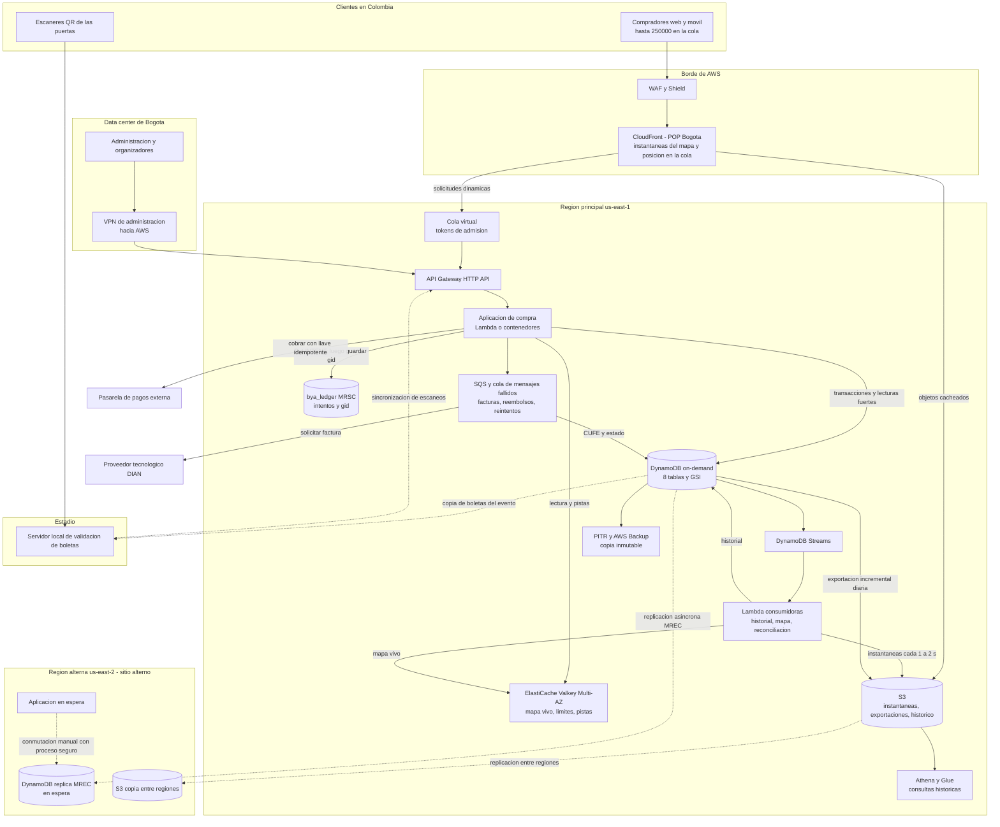
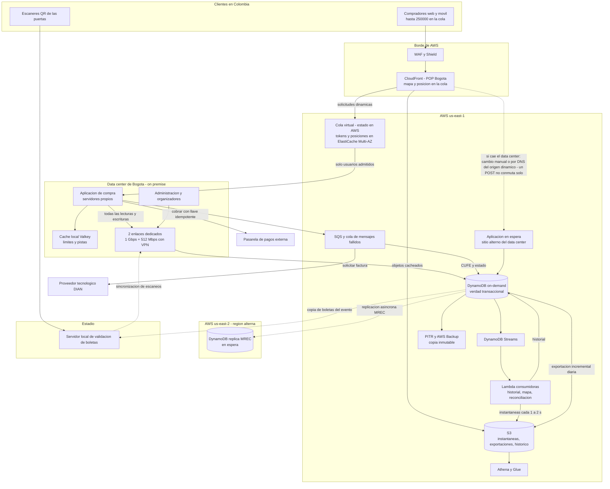
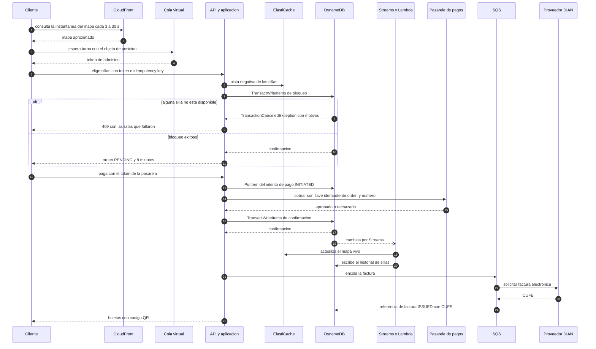

# Arquitectura — Escenarios A y B, región y latencia (BoletaYa SAS, DynamoDB)

**Autor:** Jacobo · **Fecha:** 2026-10-29 · **Criterio de rúbrica:** Arquitectura (10 %).
Modelo de datos: [`modelo_datos.md`](modelo_datos.md) · Cifras: [`capacidad_y_volumetria.md`](capacidad_y_volumetria.md) · Fuentes `[R-xx]`: [`referencias.md`](referencias.md).

> **Regla de este documento:** cada componente que aparece en un diagrama está explicado en el texto (tablas "Componentes"). No dibujo nada que no haya justificado. **Alcance del curso:** es un diseño; no se creó, probó ni midió ninguna infraestructura.

---

## 0. Resumen

| Tema | Decisión |
|---|---|
| **Región principal** | **us-east-1 (N. Virginia)**: ≈ **77 ms** desde Bogotá frente a ≈ **112 ms** de São Paulo (ping medido por un tercero, ver §1), **−33 %** de precio de DynamoDB y única entre las candidatas con **MRSC** para datos sin transacciones (pero MRSC no sirve para la compra). |
| **Región alterna** | **us-east-2 (Ohio)** con réplica **MREC** en espera (**una sola región escribe**). |
| **Escenario A** | Ruta crítica en AWS: CloudFront → cola virtual → API/aplicación → DynamoDB on-demand + ElastiCache + S3/Athena; Bogotá = administración, conectividad y respaldo de gestión. |
| **Escenario B** | **DynamoDB no se puede instalar en el data center.** Variante **híbrida literal** del enunciado: aplicación, caché local y servidor de estadio en Bogotá; la verdad transaccional **y el estado de la cola virtual** siguen en AWS por dos enlaces dedicados a internet de proveedores distintos (1 Gbps y 512 Mbps) con una VPN Site-to-Site sobre cada uno (F-18; Direct Connect queda como mejora si la latencia medida lo exige). **Aprobado por el profesor** (respuesta 1, 2026-11-04). |
| **Efecto en la latencia de una compra** | Con la aplicación junto a la base: ≈ **22 ms** de acceso a datos por compra. Con la aplicación en Bogotá: ≈ **350 ms** (us-east-1) o ≈ **500 ms** (sa-east-1). Ambas cifras son **estimaciones** y ninguna es el tiempo total de la transacción (§5). |
| **Hallazgo crítico (para David y Miguel)** | **RPO 0 ante pérdida de una región no es alcanzable con transacciones**: MRSC no soporta transacciones ni TTL; MREC es asíncrono [R-17]. Dentro de una región (fallo de zona), sí hay RPO 0 (3 zonas) [R-01]. |

---

## 1. Región de AWS y latencia desde Bogotá

### 1.1 Datos verificados

**Latencia medida desde Bogotá** (WonderNetwork, ping entre su servidor en Bogotá y servidores de ese proveedor en otras ciudades; **consulta del 2026-10-29**, extracto en `calculos/evidencia/`) [R-25]:

| Destino (ciudad del servidor) | Distancia | Ping promedio | Mín. / Máx. | Se usa como proxy de |
|---|---:|---:|---|---|
| São Paulo | 4.319 km | **112,24 ms** | 112,06 / 112,53 | `sa-east-1` |
| Washington (D. C.) | 3.837 km | **77,13 ms** | 76,95 / 77,40 | `us-east-1` y `us-east-2` (**no medí Ohio ni N. Virginia**) |
| Miami | 2.443 km | 57,99 ms | 57,81 / 58,36 | — (referencia) |
| Ciudad de México | 3.178 km | 111,54 ms | 111,13 / 118,53 | `mx-central-1` (Querétaro; **no medido**) |
| Dallas | 3.923 km | 86,73 ms | 86,53 / 87,55 | — |
| Santiago | 4.194 km | 67,42 ms | 67,30 / 67,92 | — |

**Límites de esta evidencia (honestidad):** (1) es un ping **ICMP a servidores de un tercero**, no una medición contra un *endpoint* de AWS; (2) "Washington" no es exactamente N. Virginia; (3) no hay medición pública que haya encontrado para Bogotá → `us-east-2`; (4) la ruta de la VPN de B va por internet y puede variar más que una línea privada. Tratar los números como **estimación de red**, no como tiempo de transacción. **Acción propuesta antes de la sustentación:** un `ping`/`curl -w` desde una red de Bogotá a `dynamodb.us-east-1.amazonaws.com` y `dynamodb.sa-east-1.amazonaws.com` (acción de Juan Pablo/David desde su portátil; no crea infraestructura).

**Disponibilidad de DynamoDB** en las candidatas: `sa-east-1`, `us-east-1`, `us-east-2` y `mx-central-1` aparecen en la lista oficial de *endpoints* [R-28].

**Precios** (lista oficial AWS, versión 2026-09-11, consulta 2026-10-29, USD) [R-23, R-16]:

| Concepto | sa-east-1 | us-east-1 | mx-central-1 |
|---|---:|---:|---:|
| 1 M WRU on-demand | 0,9375 | **0,625** | 0,655 |
| 1 M RRU on-demand | 0,1875 | **0,125** | 0,1315 |
| GB-mes (Standard) | 0,375 | **0,25** | 0,2625 |
| GB-mes PITR | 0,30 | **0,20** | 0,21 |
| Athena, por TB escaneado | 9,00 | **5,00** | — |
| ElastiCache Valkey `cache.m7g.large`, por hora | 0,18 | **0,1264** | — |
| HTTP API por millón de solicitudes (primeros 300 M) | 1,59 | **1,00** | — |
| S3 Standard, GB-mes (primeros 50 TB) | 0,0405 | **0,023** | — |

**Replicación multirregión:** las tablas globales **MRSC** (RPO cero entre regiones) están disponibles en us-east-1, us-east-2, us-west-2, Canadá, Europa y Asia (lista oficial); **no** aparecen `sa-east-1` ni `mx-central-1` [R-17]. **Cuota por defecto de API Gateway:** 10.000 req/s por cuenta y región; **2.500** en `mx-central-1` [R-31].

### 1.2 Comparación

| Criterio | **us-east-1** | us-east-2 | sa-east-1 | mx-central-1 |
|---|---|---|---|---|
| Latencia desde Bogotá (estimación de red) | **≈ 77 ms** (proxy Washington) | ≈ similar (no medida) | ≈ 112 ms | ≈ 111 ms (proxy CDMX) |
| Servicios requeridos (DynamoDB, Streams, S3, Athena, CloudFront, ElastiCache, API Gateway) | Sí (DynamoDB confirmado [R-28]; resto: precios publicados en la lista oficial) | Sí | Sí | DynamoDB sí; API Gateway con cuota menor [R-31] |
| Costo DynamoDB / caché / Athena | **El menor** | = us-east-1 en DynamoDB (verificado: 0,625 / 0,125 / 0,25 / 0,20); caché y Athena no consultados | +50 % DynamoDB, +42 % caché, +80 % Athena | +5 % vs us-east-1 en DynamoDB |
| MRSC (RPO 0 entre regiones, solo sin transacciones) | Sí | Sí | **No** | **No** |
| Replicación/recuperación | Pareja natural: us-east-2 | Pareja de us-east-1 | Sin MRSC; MREC hacia otra región | Sin MRSC |
| Transferencia entre regiones | Replicación MREC cobra "escritura replicada" (0,625 USD/M en us-east-1) [R-23] | Idem | 0,9375 USD/M | 0,655 USD/M |
| Datos personales (Ley 1581) | Fuera de Colombia → análisis de transferencia internacional. EE. UU. figura en la lista de países con nivel adecuado de la SIC (Circular 005 de 2017, **fuente secundaria**) [R-35] | Idem | Brasil **no** figuraba en esa lista; en 2026 aparece como **candidato** [R-35] | México figura como país adecuado (fuente secundaria) [R-35] |

**Nota legal:** **no es mi análisis.** Samuel debe verificar el numeral vigente de la Circular Única de la SIC y la Ley 1581; yo solo dejo el insumo. Si el equipo decidiera que los datos deben quedar en Latinoamérica, la alternativa es `sa-east-1` con **+35 ms, +50 % en DynamoDB y sin MRSC**.

### 1.3 Recomendación

**Región principal: `us-east-1`. Región alterna: `us-east-2`.** Razones en orden de peso: (1) **menor latencia medida** entre las regiones con funcionalidades completas (77 vs 112 ms); (2) **precio** (−33 % DynamoDB; −29 % caché; −44 % Athena); (3) pareja de recuperación con MRSC disponible; (4) **la diferencia de costo de DynamoDB es pequeña** (≈ USD 175/año en el año 1), así que la decisión se apoya en latencia, funciones y datos personales, no en el precio de la base. **Sacrificio:** dependencia de una región fuera de Colombia y de la **validación legal pendiente**. **Riesgo que invalidaría la propuesta:** que la SIC/Ley 1581 impida alojar los datos en EE. UU. (entonces `sa-east-1`).

---

## 2. Escenario A — Nube asignada (propuesta principal)

### 2.1 Alcance e interpretación

El enunciado dice "la aplicación vivirá en el data center de Bogotá" y que "dónde vive la base de datos es parte de su decisión". Para A propongo **desplegar la ruta crítica de compra junto a la base en AWS** y dejar en Bogotá lo que no es crítico para latencia (administración, organizadores, respaldos de gestión). **Esto interpreta el enunciado y debe confirmarlo el profesor (P-3):** si exigiera la aplicación **físicamente** en Bogotá, A coincide con el escenario B de la §3 (misma topología).

### 2.2 Diagrama

### 2.3 Componentes (cada uno, con su porqué)

| Componente | Qué hace | Por qué está |
|---|---|---|
| **CloudFront (POP Bogotá)** | Sirve las **instantáneas del mapa** y el objeto de **posición en la cola**; entrega estáticos | Absorbe 8.333–203.000 req/s del mapa (capacidad §6) para que DynamoDB vea ≈ 450 RRU/s. CloudFront tiene punto de presencia en Bogotá [R-26]. Opcional: *Origin Shield* (capa extra que consolida las solicitudes al origen; con costo; ofrecido en us-east-1 y sa-east-1) [R-32] |
| **WAF y Shield** | Filtro de bots y DDoS en el borde | Protege la cola y la API; el diseño de datos solo añade los límites por usuario (Samuel/David) |
| **Cola virtual** | Controla cuántos compradores entran a la fase transaccional (concurrencia objetivo ≈ 4.800; ráfaga ×5 ≈ 24.000) | Evita que 250.000 personas golpeen las sillas. El producto "Virtual Waiting Room on AWS" está **discontinuado** [R-29]; opciones: construcción propia con CloudFront Functions o un producto de AWS Marketplace; patrón de referencia: SeatGeek con DynamoDB + Lambda [R-30]. **Costo: PENDIENTE (Juan Pablo)** |
| **API Gateway HTTP API** | Puerta de las llamadas dinámicas; autorización por token de admisión | Cuota por defecto 10.000 req/s [R-31] vs. 2.000 req/s del pico ×5 (supuesto de 20 llamadas por orden) |
| **Aplicación de compra** | Lógica de la compra (§7 del modelo), reintentos con *backoff*, idempotencia | Sin estado; todo el estado vive en DynamoDB |
| **ElastiCache Valkey Multi-AZ** | Mapa vivo (mapas de bits), límites de ritmo, pistas negativas de sillas | **Nunca** es fuente para confirmar una silla. Su pérdida degrada pero no corrompe |
| **DynamoDB on-demand (8 tablas)** | **Verdad transaccional**: sillas, órdenes, pagos, boletas, contadores | `modelo_datos.md`. 3 zonas de disponibilidad por defecto, SLA 99,99 % [R-01, R-22] |
| **DynamoDB Streams + Lambda** | Derivan historial de sillas, mapa vivo y agregados | Retención 24 h; consumidores idempotentes [R-11] |
| **SQS + cola de mensajes fallidos** | Factura electrónica, conciliación con la pasarela, reembolsos | Desacopla y permite reintentos (David) |
| **S3** | Instantáneas del mapa, exportaciones, histórico y archivos | Barato; exportaciones DynamoDB→S3 sin consumir RCU [R-09] |
| **Athena + Glue** | Consultas sobre histórico y analítica | Separa lo analítico de lo operativo (nunca `Scan` sobre producción) |
| **PITR + AWS Backup** | Restauración a un punto (hasta 35 días) y copias | No consumen capacidad ni afectan el rendimiento [R-01]; el plan es de Miguel |
| **Región alterna us-east-2** | Réplica MREC en espera + aplicación en espera + copia de S3 | Sitio alterno ante pérdida de región; **una sola región escribe** (§4.1) |
| **Data center de Bogotá + VPN** | Administración y organizadores; enlace de gestión | En A la venta no pasa por Bogotá; Direct Connect existe en Equinix BG1 (1G/10G/100G) [R-27, R-39] pero no se usa |
| **Servidor local de validación (estadio)** | Valida QR sin internet con la copia de las boletas del evento; registra usadas | Lo diseña David; aquí solo se dibuja su conexión y de dónde sale su copia (`gsi_evento_boleta`, AP-18) |
| **Pasarela de pagos / Proveedor DIAN** | Externos: cobro y factura electrónica | La base guarda solo token y CUFE, nunca tarjeta |

---

## 2.5 Por qué DynamoDB no puede ejecutarse *on premise* (máximo 2 páginas)

Amazon DynamoDB es un servicio administrado regional de AWS. El cliente consume sus endpoints y APIs, pero AWS opera el plano de control, la replicación entre zonas, la disponibilidad y el almacenamiento. No existe una licencia o instalador para desplegar el servicio completo en servidores propios. Por eso, “DynamoDB en el centro de datos de Bogotá” no es una opción de arquitectura que se pueda cotizar o implementar como si fuera PostgreSQL.

**DynamoDB Local no es producción.** AWS lo documenta como herramienta de desarrollo y pruebas: emula la API localmente, no ofrece el servicio administrado ni sus garantías, y no sustituye la replicación multi-AZ, escalado, backups/PITR, control de capacidad, alta disponibilidad ni SLA de DynamoDB. Ponerlo detrás de una API compatible no convierte la emulación en el servicio de producción. Por tanto, no se recomienda para ventas reales ni para la fuente de verdad de pagos y sillas.

**Alternativa compatible: motor de terceros con API compatible con DynamoDB.** Hay productos que implementan una API similar y pueden instalarse en infraestructura propia. Compatibilidad de protocolo no demuestra equivalencia semántica: antes de migrar habría que validar transacciones, condiciones de escritura, aislamiento, consistencia, límites de tamaño, índices, TTL, Streams, replicación, backups, SDK y comportamiento bajo falla. También se perdería la operación administrada y la garantía/SLA de AWS; el equipo asumiría parches, capacidad, recuperación y soporte del fabricante. Como el curso asigna DynamoDB y no exige independencia de nube, cambiar el motor agregaría riesgo, costo de prueba y diferencias de comportamiento sin resolver un requisito confirmado. No se propone diseñarlo ni sustituirlo.

**Diseño aceptado por el profesor para B: híbrido.** La aplicación y caché local y los sistemas del estadio están en Bogotá; DynamoDB permanece en AWS y se accede por dos enlaces dedicados a internet de proveedores distintos (1 Gbps y 512 Mbps) con una VPN Site-to-Site sobre cada uno (F-18; Direct Connect queda como mejora si la latencia medida lo exige). Así se conserva el motor asignado. La aplicación tolera latencia de red y la validación final de cada silla es transaccional en DynamoDB; la VPN cifra el tráfico, pero no elimina la latencia ni la dependencia de los enlaces. Si caen los dos enlaces, el estadio sigue admitiendo con su copia local y el ingreso se reconcilia después; la venta en línea se pausa o conmuta según el runbook.

**Conclusión:** no desplegar DynamoDB Local ni una reimplementación de API como producción. Usar DynamoDB administrado en AWS en ambos escenarios. B es una variante híbrida de aplicación/conectividad aprobada por el profesor, no una instalación local de la base. Fuente oficial: [DynamoDB Local](https://docs.aws.amazon.com/amazondynamodb/latest/developerguide/DynamoDBLocal.html), descrito por AWS para desarrollo y pruebas; ver también [arquitectura de DynamoDB](https://docs.aws.amazon.com/amazondynamodb/latest/developerguide/Introduction.html).

## 3. Escenario B — On premise / híbrido

### 3.1 La dificultad que no se puede ignorar

**DynamoDB es un servicio administrado de AWS.** Lo verifiqué así: (1) la documentación lo define como "serverless, fully managed" y sin versiones ni ediciones [R-01]; (2) **DynamoDB local** es una versión descargable que AWS presenta **para desarrollar y probar** aplicaciones [R-33], no como alternativa de producción; (3) **AWS Outposts** extiende la región al DC, pero DynamoDB **no figura** entre los servicios que corren localmente (inferencia a partir de las listas de servicios consultadas; la tabla vive en la región) [R-34]. **Por tanto no dibujo DynamoDB instalado en Bogotá ni invento una edición on premise.**

### 3.2 Propuesta provisional (a confirmar con el profesor)

El enunciado acepta "una solución híbrida … como variante de cualquiera de los dos escenarios". La variante coherente con DynamoDB es:

> **B-híbrido:** la **aplicación**, una **caché local** y el **servidor de estadio** viven en el data center de Bogotá (lo que el enunciado ya ubica allí); el **motor transaccional sigue siendo DynamoDB en AWS** (misma región recomendada), accedido por dos enlaces dedicados a internet de proveedores distintos (1 Gbps y 512 Mbps) con una VPN Site-to-Site sobre cada uno (F-18; Direct Connect queda como mejora si la latencia medida lo exige). El mapa y la cola siguen saliendo de CloudFront.

**Pregunta P-1 para el profesor (junto a David y Juan Pablo):** *"DynamoDB no puede instalarse en el data center. ¿Se acepta como Escenario B la variante híbrida con aplicación y caché on premise y la base en AWS, o debe interpretarse B de otra forma (p. ej., eximirlo o limitarlo a los componentes auxiliares)?"*

### 3.3 Diagrama

### 3.4 Qué vive dónde

| En **Bogotá** | En **AWS** |
|---|---|
| Aplicación de compra, caché local, administración, servidor de estadio (en el recinto), extremo del enlace | **DynamoDB (verdad transaccional)**, **cola virtual con su estado (tokens y posiciones)**, Streams, Lambda, SQS, S3, Athena, respaldos, región alterna, CloudFront, WAF, aplicación en espera |

**Ventajas del componente local:** (1) cumple literalmente el enunciado (la aplicación en el DC); (2) la caché local está cerca del usuario colombiano; (3) servicios de administración sin salida a Internet; (4) el estadio se integra con el DC sin depender de la nube para operar.
**Riesgos de depender de la conectividad:** (1) **todas** las lecturas y escrituras cruzan el enlace → si cae, **no se vende** (el mapa y la posición en la cola siguen porque salen de CloudFront/S3 y del estado de la cola en AWS, pero sin transacción no hay compra); (2) latencia por llamada +77–112 ms (§5); (3) el DC es un solo sitio (rack, UPS, aire; no tiene servidores ni planta); (4) un solo enlace no da redundancia: por eso hay dos enlaces de proveedores distintos, cada uno con su VPN, y **conmutación de la venta a la aplicación en espera en AWS**: el *origin failover* de CloudFront **solo conmuta solicitudes `GET`, `HEAD` y `OPTIONS`; no conmuta `POST` ni `PUT`** [R-40] (hallazgo H-1 de Miguel), y la compra es de escritura, así que la venta se conmuta **por DNS o cambiando el origen a mano** (runbook 2c de Miguel); CloudFront sí puede conmutar solo lo que es `GET` (consultas de estado de la orden). RTO de 3 a 11 min desde la declaración (Miguel, runbook 2c); (5) **si la cola viviera en Bogotá**, al caer el DC se perdería el lugar de hasta 250.000 personas aunque la base estuviera intacta (hallazgo H-4 de Miguel): por eso **el estado de la cola está en AWS** (ElastiCache Multi-AZ; si se perdiera, se readmite por sorteo y se documenta); (6) hardware, garantía, energía (PUE 1,8; COP 900/kWh) y administración están en `entrega/costos_boletaya_final.xlsx`.

### 3.5 Comparación A vs B en lo que me corresponde

| Aspecto | A | B |
|---|---|---|
| Latencia de acceso a datos por compra | ≈ 22 ms | ≈ 350 ms (us-east-1) |
| Dependencia del enlace con Bogotá | Solo administración | **Crítica** (toda venta) |
| Capacidad de pico | CloudFront + AWS elástico | Caja de Bogotá limitada por hardware |
| Hardware y energía | No | Sí |
| Cumplimiento literal del enunciado | Requiere aprobación (P-3) | Sí, sujeto a P-1 |
| Recomendación técnica | **Preferida** | Aceptable solo con enlace redundante y aplicación en espera en AWS |

---

## 4. Recorrido de una compra (Escenario A)

**Texto del recorrido.**

1. **Mapa y cola:** el cliente nunca consulta DynamoDB; lee instantáneas en CloudFront y espera turno con un objeto cacheable (§6.3 de capacidad).
2. **Admisión:** recibe un token que autoriza llamadas dinámicas.
3. **Elegir sillas:** la API consulta la pista negativa (solo para ahorrar transacciones inútiles) y ejecuta **una** `TransactWriteItems` que bloquea todas las sillas, crea la orden `PENDING` y cobra el límite por usuario. Si una falla, se cancela **todo** y el cliente recibe cuáles sillas fallaron.
4. **Pagar:** se registra el intento (`INITIATED`), se cobra con **llave idempotente** `<orden>#<n>` en la pasarela; si se rechaza, se marca `DECLINED` (el bloqueo sigue vigente) y se permite otro intento.
5. **Confirmar:** **una** `TransactWriteItems` pasa las sillas a vendidas, la orden a `PAID`, el intento a `APPROVED`, incrementa el contador fragmentado, crea las boletas y la referencia de factura `PENDING`.
6. **Derivados:** Streams alimenta el mapa vivo y el historial; SQS pide la factura al proveedor DIAN y escribe el CUFE.
7. **Entrega:** el cliente recibe las boletas con QR. Si la confirmación falla porque otro tomó la silla **después** de vencer el bloqueo, la orden pasa a `FULFILL_FAIL` y se reembolsa (escenario 2 de David).

### 4.1 Alta disponibilidad y conmutación (insumos; el estudio lo hace David)

| Mecanismo | Qué garantiza | Qué **no** garantiza | Efecto en el tiempo de respuesta | Fuente |
|---|---|---|---|---|
| Replicación automática en **3 zonas** de la región | Durabilidad y **RPO 0** ante fallo de zona; SLA **99,99 %** mensual | No cubre pérdida de región | Incluido en el "milisegundo de un dígito" del servicio; **sin modo de conmutación que configurar** | [R-01, R-22] |
| Tabla global **MREC** | Réplica en otra región; replicación "típicamente en un segundo o menos"; SLA **99,999 %** (Global Tables SLA) | **RPO > 0** ("igual al retraso de replicación, normalmente unos segundos"); resolución de conflictos **"última escritura gana"**; las transacciones solo son atómicas en la región de origen (otra región puede ver transacciones parciales) | **Ninguno** en la escritura (es asíncrona) | [R-17, R-22] |
| Tabla global **MRSC** | RPO **0** entre regiones; lecturas fuertes en cualquier réplica | **No soporta transacciones ni TTL**; no está en sa-east-1 | **Sube la latencia de escritura** (cruza regiones) | [R-17] |

**Consecuencias (decisiones D-2 y D-3 de `entrega_para_el_equipo.md`):**

1. **La compra usa transacciones ⇒ no puede usar MRSC.** Entonces el RPO 0 de **pagos** ante pérdida de **región** se logra **a nivel de proceso**: la pasarela es la fuente de verdad del dinero; tras conmutar, se **concilia** contra la pasarela y se reaplican las órdenes pagadas antes de reabrir ventas.
2. **Una sola región escribe (activa-pasiva).** Con MREC y dos regiones escribiendo, "última escritura gana" podría vender la **misma silla** en ambas. La aplicación en la región alterna permanece **sin escrituras** hasta declarar el desastre.
3. **Riesgo de doble venta tras conmutación entre regiones:** una venta confirmada en el último segundo antes del fallo puede no haberse replicado; en la región alterna esa silla aparecería libre. **Mitigación obligatoria:** modo seguro tras conmutar (conciliar contra pasarela y marcar vendidas las sillas de pagos aprobados **antes** de abrir). Residual a evaluar por David/Miguel.
4. El enunciado mide el RTO **"desde que se declara la falla"** (§3): **detección y decisión quedan fuera** y se reportan aparte (hallazgo H-2 de Miguel). Desde la declaración suma: congelar ventas + cambiar tráfico (DNS u origen) + aplicación lista + conciliar + verificar contadores + reabrir. Miguel y David lo estiman en **4 a 11 min desde la declaración** (la conciliación queda fuera del RTO por la respuesta 6 del profesor), con casi todos los tiempos **supuestos** (`miguel/recuperacion_licenciamiento_carta.md`). **No lo calculo aquí** (es de David y Miguel).
5. **Condiciones con que David y Miguel aceptaron D-2:** (a) la lista de sillas de un pago aprobado vive en `ORDER.sil` y puede no haberse replicado: se registra cada intento con silla y orden en `bya_ledger` MRSC antes del cobro; al cobrar se persiste `gid`. La búsqueda por rango de Mercado Pago no funcionó en sandbox, por lo que las sillas en duda se consultan desde el ledger por minuto y el estado de cada pago se consulta por `gid`. La conciliación no parte de `gsi_pendientes`. El ledger no forma parte de la transacción de compra.
6. **La réplica debe estar pre-calentada** (hallazgo de David, `alta_disponibilidad.md` §7): la documentación indica que el `warm throughput` de una tabla global se aplica automáticamente a todas las réplicas [R-18]. Al volver la región original **no recibe tráfico ni escrituras**; sus ítems pendientes se comparan con la pasarela antes de converger (`miguel/respuesta_a_david.md` §4).

---

## 5. Latencia de una compra: qué mide y qué no

**La latencia de red no es el tiempo de la transacción.** El tiempo percibido incluye: ida y vuelta usuario↔borde (no medido), borde↔origen, **tiempo de la pasarela** (externo, el mismo en A y B), aplicación y **n viajes a la base**. Lo que cambia entre A y B es **solo** el tramo aplicación↔base:

* **A (aplicación junto a la base):** T_datos = n × s
* **B (aplicación en Bogotá):** T_datos = n × (RTT + s)

con **n ≈ 4,3** viajes secuenciales a DynamoDB por compra (bloqueo 1 + registrar intento 1 + rechazo 0,3 + confirmación 1 + leer boletas 1) y **s = 5 ms** (**A-12:** "milisegundo de un dígito" que publica AWS para el servicio [R-01] más red dentro de la región; es un **supuesto**, no una medición).

| Caso | RTT usado | Cálculo | T_datos por compra |
|---|---:|---|---:|
| A: aplicación en la región | — | 4,3 × 5 ms | **≈ 22 ms** |
| B con us-east-1 | 77,13 ms | 4,3 × (77,13 + 5) | **≈ 353 ms** |
| B con sa-east-1 | 112,24 ms | 4,3 × (112,24 + 5) | **≈ 504 ms** |

**Cómo leerlo.** (1) Son **décimas de segundo** frente a una ventana de bloqueo de **480 s** (0,07–0,1 %): no cambian la experiencia del cliente, pero sí la **capacidad** (concurrencia de conexiones: 100 órdenes/s × 0,353 s ≈ 35 llamadas en vuelo, trivial) y la **fragilidad** (más llamadas cruzando un enlace). (2) El tramo usuario↔origen **no está medido** y en A añade el salto borde→región; por eso **no afirmo** que A sea más rápido de punta a punta, solo que su tramo de datos es ≈ 16 veces menor. (3) La **alta disponibilidad** dentro de la región no añade latencia visible; MREC tampoco; solo MRSC la añadiría y **no se puede usar** (§4.1).

---

## 6. Qué consultas van a la base principal y cuáles no

| Consulta | Destino | Razón |
|---|---|---|
| Mapa de sillas (250.000 personas) | **CloudFront + S3** (instantáneas), alimentadas por Streams y reconstrucción periódica | 8.333–203.000 req/s; directo a DynamoDB = 5,7×–139,9× la cuota por tabla |
| Posición en la cola | **CloudFront** (objeto cacheable) | 25.000 req/s de sondeo |
| Catálogo (evento y localidades) | **CloudFront/caché**; base en fallos | Lectura masiva, cambia poco |
| Bloqueo, confirmación, estado definitivo de silla, boleta, escaneo válido | **DynamoDB (siempre)** | Verdad transaccional |
| Contador exacto de localidad | **DynamoDB** (lectura fuerte de N fragmentos) | Exactitud; la caché solo para mostrar |
| Historial de sillas, auditoría reciente | DynamoDB | Volumen bajo |
| Histórico > 2 años, analítica, reclamos amplios | **S3 + Athena** | No se hace `Scan` sobre producción |
| Estadio sin internet | **Servidor local** | El ingreso nunca se detiene |

---

## 7. Estadio sin internet y conectividad

* **Qué recibe el servidor local antes del evento:** las boletas del evento (AP-18, 8 consultas paralelas a `gsi_evento_boleta`; ≈ 45.000 boletas ≈ 9 MB) y la clave de verificación del QR (`HMAC`). Con ellas valida sin internet la **forma y la firma** del QR y registra las usadas.
* **Qué se escribe al volver internet:** por cada boleta usada, `UpdateItem` condicional (`st = VALID → USED`) más el registro `SCAN#…` en `bya_tickets` (§3.5 del modelo). Si la boleta ya estaba `USED` en la central (p. ej., usada en otra puerta con internet), se registra `DUPLICADA`. **El diseño detallado (cómo evitar el doble ingreso entre varias puertas sin internet, equipo y su costo) es de David.**
* **Conectividad Bogotá ↔ AWS (solo B):** dos enlaces dedicados a internet de proveedores distintos (1 Gbps y 512 Mbps) con una VPN Site-to-Site sobre cada uno (F-18; Direct Connect queda como mejora si la latencia medida lo exige). Precio de los enlaces: orden de compra 160603 de Colombia Compra Eficiente. Direct Connect está disponible en **Equinix BG1, Bogotá** (1G/10G/100G) [R-27], pero su puerto, *cross-connect* y circuito no tienen precio publicado. **Local Zone de Bogotá:** AWS la anunció (2021–2023) pero **no encontré confirmación de que esté disponible**; no la uso [R-38]. Costos: `entrega/costos_boletaya_final.xlsx`.

---

## 8. Riesgos de arquitectura

| # | Riesgo | Mitigación | Estado |
|---|---|---|---|
| A-R1 | Pérdida de región con RPO > 0 → posible doble venta tras conmutar | Modo seguro con conciliación contra pasarela; una sola región escribe | Decisión D-2 |
| A-R2 | Cola virtual: producto de AWS discontinuado; costo desconocido | Construcción propia o Marketplace; costear | PENDIENTE (Juan Pablo) |
| A-R3 | Datos personales fuera de Colombia | Validación de Samuel; plan B `sa-east-1` | PENDIENTE (Samuel) |
| A-R4 | Latencia a us-east-2 y por la VPN de B no medida | Medir con `ping`/`curl` desde Bogotá antes de la sustentación | PENDIENTE |
| A-R5 | B depende del enlace: sin enlace no hay ventas | Doble camino + aplicación en espera en AWS + **conmutación de la venta por DNS o manual** (CloudFront no conmuta `POST` [R-40]) | Diseño; RTO PENDIENTE (Miguel) |
| A-R8 | Cola virtual en el DC de Bogotá: al caer, 250.000 personas pierden su lugar | Estado de la cola en AWS (ElastiCache Multi-AZ); si se pierde, readmisión por sorteo | Corregido en el diagrama B (H-4) |
| A-R6 | Retraso del mapa (≈ 3–6 s estimado) | Aceptado: el estado definitivo es la transacción | Estimación |
| A-R7 | Derivados dependen de Streams (retención 24 h) | DLQ, alarma de edad del iterador, reconstrucción periódica | Diseño |

---

## 9. Comprobación de coherencia diagramas ↔ texto

| Nodo del diagrama | Explicado en | | Nodo | Explicado en |
|---|---|---|---|---|
| USR, ESC | §2.3 (clientes), §7 | | DDB2, APP2/APPS, S3B | §2.3 (región alterna), §4.1 |
| WAF, CDN | §2.3 | | BO, VPN/GW | §2.3, §3.4, §7 |
| COLA/COLAB | §2.3 | | SRV | §2.3, §7 |
| API, APP/APPB | §2.3, §3.4 | | PAS, DIAN | §2.3 |
| CACHE/CACHEB | §2.3, §3.4 | | STR, LMB, SQS | §2.3 |
| DDB | §2.3, modelo_datos | | S3, ATH, BKP | §2.3 |

Los diagramas de A y B muestran las mismas fuentes de datos (DynamoDB, Streams, Lambda, SQS, S3, Athena, PITR/Backup) y difieren **solo** en dónde viven la aplicación, la caché y la cola, y en por dónde cruza el tráfico a la base.

### 4. AWS en Colombia y latencia (verificación al 4-nov-2026)

AWS no lista una región de infraestructura en Colombia y DynamoDB no está disponible en una región colombiana. AWS sí lista Bogotá como **Local Zone anunciada** `us-east-1-bog-1a`, bajo la región padre us-east-1, cuyo estado es “Request interest”; no es una región local disponible para desplegar la base ni evidencia de que DynamoDB opere allí. Por eso el diseño conserva DynamoDB en us-east-1. La lista de regiones y servicios debe volver a verificarse al desplegar, porque AWS puede cambiarla. [Regiones AWS](https://docs.aws.amazon.com/global-infrastructure/latest/regions/aws-regions.html) · [Local Zones](https://aws.amazon.com/about-aws/global-infrastructure/localzones/locations/).

La medición de red disponible desde Bogotá es un proxy de tercero: 77,13 ms de ping medio a Washington para us-east-1 y 112,24 ms a São Paulo para sa-east-1 (consulta 29-oct-2026). No es latencia a un endpoint AWS ni por la VPN de B. El cálculo de compra en B (~350 ms de acceso a datos por compra) es una estimación de múltiples viajes; A (~22 ms con la aplicación junto a DynamoDB) también es una estimación. Deben rotularse como estimaciones y medirse desde Bogotá antes de producción. La Local Zone anunciada no cambia estas cifras ni se usa en el diseño actual.
